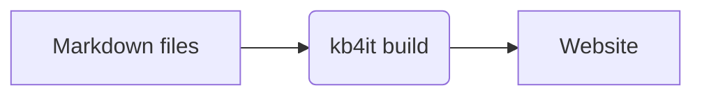

# KB4IT - Turn your Markdown files into a browsable knowledge base

[](https://pypi.org/project/KB4IT/)
[](https://pypi.org/project/KB4IT/)


**KB4IT** turns a folder of Markdown (`.md`) files with YAML frontmatter into a fast, static, property-indexed website. No database, no JavaScript framework, no runtime. Write in plain text, commit to git, generate the site, serve the static files anywhere.

- **Markdown native** - sources are plain `.md` files with a YAML frontmatter block; rendered with `python-markdown` plus the `extra`, `admonition`, `toc`, and `sane_lists` extensions, and any other extension you enable in `repo.json`.
- **Property-driven navigation** - every frontmatter property becomes a filterable index page automatically.
- **Diagrams and formulas** - a `mermaid` code block becomes a diagram, `$...$` and `$$...$$` become formulas. Mermaid and KaTeX ship with KB4IT, so they work offline and from disk, and only pages that use them load them.
- **Live preview** - `kb4it serve` rebuilds the site when you save and reloads the page in the browser.
- **Full-text search** - runs in the browser, needs no server, and also works when you open the site from disk.
- **Smart incremental builds** - only changed documents and their key/value index pages are recompiled, driven by per-document body and metadata hashes (blake2b).
- **Ready to publish** - a favicon from your logo, a 404 page, and `sitemap.xml`, `robots.txt`, an Atom feed, Open Graph tags and canonical links once you set `site_url`.
- **Links you can trust** - every document lists the documents that link to it, and `kb4it verify` reports broken links and anchors.
- **Write in the browser** - the Add page, with `"editor": true` in `repo.json` (on by default in techdoc), is a Markdown editor that completes your properties, checks the frontmatter and saves the file, offline.
- **Yours to adjust** - replace a single template per site, add your own CSS or scripts, or run Python hooks during the build.
- **Four themes out of the box** - `techdoc`, `blog`, `bookshelf` and `apphelp` - plus a custom-theme directory under `~/.kb4it/opt/resources/themes/`.
- **Runs everywhere** - GNU/Linux, macOS and Windows.

**Documentation: [t00m.github.io/KB4IT](https://t00m.github.io/KB4IT/)** - install, write, build, publish, themes and development notes.

## Live demos

See KB4IT in action with the bundled themes:

- **techdoc** - [t00mterías](https://t00m.github.io/techdoc/index.html)
- **blog** - [t00m's tech notes](https://t00m.github.io/blog/index.html)

## Source format

Every KB4IT document is a Markdown file beginning with a YAML frontmatter block. The closing `---` is the only header boundary; the title comes from the first `# H1` heading, not from the frontmatter.

```markdown
---
Author: Ann Lopez
Category: Procedure
Date: 2026-05-19
DocType: How-to guide
OS: Linux
Tag: backup, housekeeping
---

# Daily backup runbook

## Procedure

1. …
```

Frontmatter values are either scalars or comma-separated lists. Property names are case-sensitive and singular (`Tag`, `Product`, `OS`).

## Diagrams and formulas

Write the diagram source in a `mermaid` code block, and TeX between dollar signs. KB4IT draws them in the browser with the copies of [Mermaid](https://mermaid.js.org/) and [KaTeX](https://katex.org/) it ships, so the site needs no network:

````markdown


The area of a circle is $A = \pi r^2$.

$$
\sum_{k=1}^{n} k = \frac{n(n+1)}{2}
$$
````

GitHub renders the same syntax, so this is what readers see:


The area of a circle is $A = \pi r^2$.

$$
\sum_{k=1}^{n} k = \frac{n(n+1)}{2}
$$

Code blocks and inline code are never touched. To write a dollar sign as text, use `\$`. More examples: the [diagram and formula gallery](https://t00m.github.io/KB4IT/reference-diagrams-formulas.html).

## Quick start

```bash
# 1. Install KB4IT (see Installation below)
uv tool install KB4IT

# 2. Create a new knowledge base
kb4it create techdoc ~/mykb

# 3. Drop your .md files into ~/mykb/source/

# 4. Build it, serve it and rebuild it each time you save
kb4it serve ~/mykb/config/repo.json

# 5. Open the address it prints, http://127.0.0.1:8642/, in your browser
```

When you are happy with it, `kb4it build ~/mykb/config/repo.json` writes the final site to `~/mykb/target/`, ready to copy to any web server. On GitHub, the [KB4IT action](https://t00m.github.io/KB4IT/reference-github-action.html) builds it in one step: `uses: t00m/KB4IT@v0.9.0`.

## Why KB4IT?

- "I just want to drop `.md` files in a folder"
- "I want my metadata (Author, Category, Status…) to become navigation automatically"
- "I want the *output* to be static HTML"
- "I want to see my changes while I write"
- "I want it on Linux, macOS and Windows"

## Installation

**uv** - recommended, fastest.

On GNU/Linux and macOS:

```bash
curl -LsSf https://astral.sh/uv/install.sh | sh    # or, on macOS: brew install uv
uv tool install KB4IT
```

On Windows, in PowerShell:

```powershell
powershell -ExecutionPolicy ByPass -c "irm https://astral.sh/uv/install.ps1 | iex"
uv tool install KB4IT
```

**pipx** - classic isolated install:

```bash
pipx install KB4IT
```

**pip**:

```bash
pip install --user KB4IT
```

**Extras** - [nh3](https://nh3.readthedocs.io/) to clean raw HTML from documents. [PyMdown Extensions](https://facelessuser.github.io/pymdown-extensions/), for task lists, tabs, details and more, install with KB4IT itself:

```bash
uv tool install "KB4IT[extras]"
```

**Container** - Docker or Podman, nothing else to install:

```bash
docker run --rm -v "$PWD:/work" --user "$(id -u):$(id -g)" ghcr.io/t00m/kb4it build config/repo.json
```

**Linux packages** - a `.deb` and an `.rpm` for each release on the [releases page](https://github.com/t00m/KB4IT/releases); they install without internet access.

**From source**:

```bash
git clone https://github.com/t00m/KB4IT && cd KB4IT
uv tool install . --force
```

On Windows, KB4IT runs natively; the Windows Subsystem for Linux works too but is not needed.

## Requirements

- GNU/Linux, macOS 13 or newer, or Windows 10 or 11
- Python 3.11 to 3.14
- `Mako` (templating), `Markdown` (Markdown → HTML), `PyYAML` (frontmatter), `Pygments` (code highlighting), `lxml` (post-processing), `Pillow` (gallery thumbnails), `rich` and `textual` (terminal interface) - all installed automatically

## Tech stack

- **Language and packaging** - Python 3.11 to 3.14, packaged with Poetry. Distributed on PyPI, as the container image `ghcr.io/t00m/kb4it`, as a `.deb` and an `.rpm`, and as a GitHub Action.
- **Build** - `python-markdown` with `extra`, `admonition`, `toc` and `sane_lists` always on, lists nested by two, three or four spaces, plus `pymdown-extensions`; Mako templates; PyYAML frontmatter, parsed so every plain value stays the text you wrote; Pygments for build-time highlighting; lxml for post-processing; Pillow for the techdoc gallery thumbnails; nh3 for sanitizing raw HTML.
- **Output** - plain static HTML, CSS and JavaScript. No database, no server-side runtime, no JavaScript framework.
- **Frontend** - UIKit for the bundled themes, Mermaid for diagrams, KaTeX for formulas, a vanilla JavaScript full-text search engine, and a CodeMirror 6 bundle for the Add page editor. Every asset ships with KB4IT and loads from disk, offline.
- **Terminal** - Rich and Textual for the TUI.
- **Development** - pytest, with Playwright and Chromium for the browser tests; mypy in strict mode on the annotated modules; the Nu HTML Checker; GitHub Actions for CI and releases.

## Usage

```bash
kb4it create <theme> [<app>] <repo_path>  # scaffold a new repo
kb4it serve <config.json>                 # build, serve on 127.0.0.1:8642, rebuild on change, answer missing pages with 404.html
kb4it build <config.json>                 # build the site (incremental)
kb4it build <config.json> --force         # force recompile everything
kb4it verify <config.json>                # check documents and links without building
kb4it info <config.json>                  # show repo stats
kb4it themes                              # list available themes, with version, fingerprint and folder
kb4it apps <theme>                        # list theme apps
kb4it projects                            # list your knowledge bases
kb4it help                              # open the help center (--url, --dismiss)
kb4it doctor                              # show the build, Python, paths and themes; exit 1 if something bundled is missing
kb4it --version                           # show the build version and the commit it was built from
```

Run `kb4it` with no arguments in a terminal to open the terminal interface: create, build, explore and preview your projects from one screen.

A KB4IT repository is a few directories and a config file:

```
mykb/
├── config/
│   └── repo.json       # title, theme, source, target, …
├── source/             # your .md files
├── target/             # generated static website (output)
├── overrides/          # optional: your own templates and static files
├── hooks/              # optional: Python build hooks
└── var/                # build cache and logs; safe to delete
```

## Configuration

A minimal `repo.json` only needs four required keys:

```json
{
  "title":  "My Knowledge Base",
  "theme":  "techdoc",
  "source": "source",
  "target": "target"
}
```

Required (validated at load time with a clear per-key error):

- `title`  - site title shown in the navbar and `<title>`
- `theme`  - `techdoc`, `blog`, `bookshelf`, `apphelp` or a custom theme name
- `source` - directory holding the `.md` files, relative to the repository root (absolute paths work too)
- `target` - directory where the static site will be written, relative to the repository root

Common optional keys:

- `tagline`       - short subtitle
- `force`         - force full rebuild on every run (overridden by `--force`)
- `workers`       - parallel compiler workers (default: `CPU_COUNT / 2`)
- `ignored_keys`  - frontmatter keys excluded from navigation
- `logo`, `logo_alt` - navbar logo and its text; the logo is also the favicon (without it, the theme's logo is used)

New in 0.9, all optional:

- `site_url`   - public address of the site; enables `sitemap.xml`, the feed and canonical links
- `markdown`   - extra python-markdown extensions, and build-time code highlighting with Pygments
- `search`     - `false` turns off full-text search
- `feed`       - Atom feed settings (on by default in the blog theme)
- `sitemap`    - `false` turns off `sitemap.xml` and `robots.txt`
- `og_image`   - preview image for shared links
- `overrides`  - folder with your own templates and static files (default `overrides`)
- `hooks`      - Python file with build hooks
- `backlinks`  - `false` hides the "Linked from" list

Every key is described in the [repository settings reference](https://t00m.github.io/KB4IT/reference-repo-json.html).

## Themes

- **techdoc** - Technical documentation, runbooks, knowledge bases. Dense, property-heavy navigation, full-text search, event calendar.
- **blog** - Chronological posts with tags and categories, full-text search and an Atom feed.
- **bookshelf** - Study companion organised as books, parts and chapters, with reading progress and search.
- **apphelp** - Help site for an application. Works from `file://`, from a GitHub Pages subpath and embedded in the app; strict metadata, offline search, help ids and versioned help. Start with `kb4it create apphelp <path>`.

All themes draw diagrams and formulas, put a favicon in every page and show the documents that link to each page. techdoc, blog and bookshelf write a `404.html` page that web servers can show for missing pages (apphelp has its own). Custom themes live in `~/.kb4it/opt/resources/themes/<your-theme>/`; to change only one template of a theme, use the `overrides/` folder.

## Contributing

Contributions are very welcome - especially bug reports with a minimal reproducing repo, new themes, documentation improvements, and performance work on the compiler / builder.

```bash
git clone https://github.com/t00m/KB4IT
cd KB4IT
uv tool install . --force
kb4it --version
./scripts/devel/test.sh          # the tests; on Windows, run it from Git Bash
```

CI runs the tests and a build of every theme on GNU/Linux, macOS and Windows with Python 3.11, 3.13 and 3.14.

Open an issue before starting a large change so we can align on the approach.

## Roadmap / known limitations

- No online editor
- No multilingual sites yet
- No image processing (resizing, minification)
- API is still evolving; minor releases may change internals.

## Credits

- [Python](http://www.python.org/) - the language KB4IT is written in.
- [python-markdown](https://python-markdown.github.io/) - Markdown to HTML conversion.
- [Mako](https://www.makotemplates.org/) - server-side templating.
- [Pygments](https://pygments.org/) - code highlighting.
- [Mermaid](https://mermaid.js.org/) - diagrams.
- [KaTeX](https://katex.org/) - math formulas.
- [UIKit](https://getuikit.com) - the front-end framework used by the bundled themes.
- [CodeMirror](https://codemirror.net/) - the Markdown editor of the Add page.
- [Geany](https://www.geany.org/) - the editor used to build KB4IT.

## License

KB4IT is released under the [GNU GPL v3 or later](LICENSE).

## Contact

Tomás Vírseda (aka **t00m**) - tomasvirseda@gmail.com

If KB4IT is useful to you, star the repo - it genuinely helps me decide where to spend time. Issues, ideas, and PRs are all welcome.
