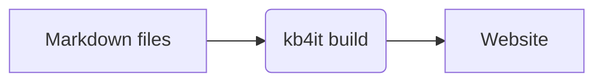

# KB4IT - Turn your Markdown files into a browsable knowledge base

[](https://pypi.org/project/KB4IT/)
[](https://pypi.org/project/KB4IT/)
[](https://github.com/t00m/KB4IT/actions/workflows/kb4it.yml)
[](https://github.com/t00m/KB4IT/blob/master/LICENSE)


**Documentation: [t00m.github.io/KB4IT](https://t00m.github.io/KB4IT/)**: install, write, build, publish, themes and development notes.

## What is KB4IT?

KB4IT is a static website generator for technical documentation. It reads a folder of Markdown (`.md`) files with a YAML frontmatter block and writes a static website where every frontmatter property becomes navigation. No database, no server-side runtime, no JavaScript framework: write in plain text, keep it in git, build the site and copy the files to any web server, or open them from disk.

- **Markdown native**: sources are plain `.md` files, rendered with `python-markdown` (`extra`, `admonition`, `toc` and `sane_lists` always on, task lists in every sample) plus any extension you enable in `repo.json`.
- **Property-driven navigation**: every property (`Author`, `Category`, `Tag`, ...) gets an index page and a page per value, built automatically.
- **Incremental builds**: only the documents that changed, and the index pages that list them, are compiled again.
- **Live preview**: `kb4it serve` rebuilds the site when you save and reloads the page in the browser.
- **Full-text search** in the browser, with no server, also when you open the site from disk.
- **Diagrams and formulas**: a `mermaid` code block becomes a diagram, `$...$` and `$$...$$` become formulas. Mermaid and KaTeX ship with KB4IT, so they work offline.
- **Ready to publish**: a favicon, a 404 page and schema.org structured data in every site; `sitemap.xml`, `robots.txt`, an Atom feed, Open Graph tags and canonical links once you set `site_url`.
- **Links you can trust**: every document lists the documents that link to it, and `kb4it verify` reports broken links and anchors.
- **Author profiles**: a `PROFILE-<name>.md` file describes a person, shown on the page of everything they wrote.
- **Write in the browser**: the Add page, on by default in techdoc, is an offline Markdown editor that completes your properties, checks the frontmatter and saves the file.
- **Yours to adjust**: replace one template per site, add your own CSS or scripts, or run Python hooks during the build.
- **Four themes**: `techdoc`, `blog`, `bookshelf` and `apphelp`, plus your own themes under `~/.kb4it/opt/resources/themes/`.
- **Terminal interface**: run `kb4it` with no arguments to create, build, explore and preview your projects from one screen.

## Screenshots

| techdoc | blog | bookshelf |
|---|---|---|
| [](https://t00m.github.io/KB4IT/resources/images/techdoc.webp) | [](https://t00m.github.io/KB4IT/resources/images/blog.webp) | [](https://t00m.github.io/KB4IT/resources/images/bookshelf.webp) |

**[More screenshots](https://t00m.github.io/KB4IT/gallery.html)**: document pages, property pages, the apphelp theme and the terminal interface.

Live sites built with KB4IT: [techdoc](https://t00m.github.io/techdoc/index.html), [blog](https://t00m.github.io/blog/index.html), and [this help](https://t00m.github.io/KB4IT/) (apphelp).

## Prerequisites

- GNU/Linux, macOS 13 or newer, or Windows 10 or 11.
- Python 3.11 to 3.14 (CI tests 3.11, 3.13 and 3.14 on all three systems). uv can install Python for you.
- Everything else is installed with KB4IT: Mako, Markdown, PyMdown Extensions, PyYAML, Pygments, lxml, Pillow, Rich, Textual and argcomplete (plus tzdata on Windows).

The container image and the Linux packages need no Python setup of your own.

## Installation

**uv** (recommended). On GNU/Linux and macOS:

```bash
curl -LsSf https://astral.sh/uv/install.sh | sh    # only if you do not have uv yet (or: brew install uv)
uv tool install KB4IT
```

On Windows, in PowerShell:

```powershell
powershell -ExecutionPolicy ByPass -c "irm https://astral.sh/uv/install.ps1 | iex"
uv tool install KB4IT
```

**pipx** or **pip**:

```bash
pipx install KB4IT
pip install --user KB4IT
```

**Extras**: `KB4IT[extras]` adds [nh3](https://nh3.readthedocs.io/), which cleans raw HTML out of documents when `markdown.sanitize` is on:

```bash
uv tool install "KB4IT[extras]"
```

**Container** (Docker or Podman, amd64 and arm64), run from the folder of your knowledge base:

```bash
docker run --rm -v "$PWD:/work" --user "$(id -u):$(id -g)" ghcr.io/t00m/kb4it build config/repo.json
```

**Linux packages**: each [release](https://github.com/t00m/KB4IT/releases) has a `.deb` (Debian 12+, Ubuntu 24.04+) and an `.rpm` (Fedora, RHEL 9+) for x86_64 and aarch64. They install without internet access:

```bash
sudo apt install ./kb4it_X.Y.Z_amd64.deb      # or: sudo dnf install ./kb4it-X.Y.Z-1.x86_64.rpm
```

**GitHub Action**: `uses: t00m/KB4IT@vX.Y.Z` builds a site in a workflow; see [the action reference](https://t00m.github.io/KB4IT/reference-github-action.html).

**From source**: the source installer builds the same wheel as a release, with the offline help and the build stamp, installs it with uv, pipx or a virtual environment, and checks the result:

```bash
git clone https://github.com/t00m/KB4IT && cd KB4IT
scripts/install/local/install_kb4it_from_source.sh
```

Check any installation with `kb4it --version` and `kb4it doctor`. More options, upgrades and removal: [Install KB4IT](https://t00m.github.io/KB4IT/howto-install.html).

## Quick start

```bash
kb4it create techdoc ~/mykb                 # 1. a new knowledge base from the techdoc theme
                                            # 2. put your .md files in ~/mykb/source/
kb4it serve ~/mykb/config/repo.json         # 3. build, serve at http://127.0.0.1:8642/, rebuild when you save
kb4it build ~/mykb/config/repo.json         # 4. write the final site to ~/mykb/target/
```

`~/mykb/target/` is ready to copy to any web server. To start from another theme, use `blog`, `bookshelf` or `apphelp`; `kb4it apps <theme>` lists the sample apps of a theme (`kb4it create techdoc sapbasis ~/mykb`).

## Usage

```bash
kb4it create <theme> [<app>] <repo_path>  # new knowledge base (--index yes|no: may search engines index it)
kb4it serve <config>                      # build, serve on 127.0.0.1:8642, rebuild on change (--port, --host, --open, ...)
kb4it build <config>                      # build the site, incremental (-f/--force: everything; --trace: timings)
kb4it verify <config>                     # check documents, links and theme rules without building
kb4it info <config>                       # show the main settings
kb4it themes                              # list the installed themes, with version, fingerprint and folder
kb4it apps <theme>                        # list the sample apps of a theme
kb4it projects                            # list your knowledge bases
kb4it doctor                              # show the build, Python, paths and themes; exit 1 if something bundled is missing
kb4it help                                # open the offline help (--url: print the online address)
kb4it --version                           # show the build version and the commit it was built from
```

`<config>` is the path of `config/repo.json`. Every command and option, and the exit status: [Command line](https://t00m.github.io/KB4IT/reference-command-line.html).

A knowledge base is a few folders and a config file:

```
mykb/
├── config/
│   └── repo.json       # title, theme, source, target, ...
├── source/             # your .md files
├── target/             # the generated website
├── overrides/          # optional: your own templates and static files
├── hooks/              # optional: Python build hooks
└── var/                # build cache and logs; safe to delete
```

## Source format

A KB4IT document is a Markdown file that starts with a YAML frontmatter block. The title is the first `# ` heading, not a frontmatter key.

```markdown
---
Author: Ann Lopez
Category: Procedure
Date: 2026-05-19
DocType: How-to guide
OS: Linux
Tag: backup, housekeeping
---

# Daily backup runbook

## Procedure

1. ...
```

Values are text or comma-separated lists. Property names are case-sensitive and singular (`Tag`, `Product`, `OS`). See [Document format](https://t00m.github.io/KB4IT/reference-document-format.html).

## Diagrams and formulas

Write the diagram source in a `mermaid` code block, and TeX between dollar signs:

````markdown


The area of a circle is $A = \pi r^2$.

$$
\sum_{k=1}^{n} k = \frac{n(n+1)}{2}
$$
````

GitHub renders the same syntax, so this is what readers see:


The area of a circle is $A = \pi r^2$.

$$
\sum_{k=1}^{n} k = \frac{n(n+1)}{2}
$$

Code blocks and inline code are never touched. To write a dollar sign as text, use `\$`. More examples: the [diagram and formula gallery](https://t00m.github.io/KB4IT/reference-diagrams-formulas.html).

## Configuration

A minimal `config/repo.json` needs four keys:

```json
{
  "title":  "My Knowledge Base",
  "theme":  "techdoc",
  "source": "source",
  "target": "target"
}
```

- `title`: site title, shown in the header and the browser tab.
- `theme`: `techdoc`, `blog`, `bookshelf`, `apphelp` or the name of your own theme.
- `source`, `target`: the folder with the `.md` files and the folder the website is written to. `kb4it create` writes absolute paths; relative paths are read from the knowledge base folder, which suits a knowledge base kept in git or built in CI.

The most used optional keys:

| Key | Does |
|---|---|
| `tagline`, `logo`, `logo_alt` | Subtitle, and the logo (also the favicon) with its text |
| `site_url` | Public address of the site; turns on `sitemap.xml`, the feed and canonical links |
| `seo` | Language, structured data and whether search engines may index the site (`"index": true` or `false`) |
| `markdown` | More python-markdown extensions, build-time highlighting with Pygments, `sanitize` |
| `search`, `editor`, `backlinks`, `sitemap`, `feed` | Turn the search, the Add page, the "Linked from" list, the sitemap and the Atom feed on or off |
| `profiles` | Which properties have profiles (default: `Author` as a person) |
| `timezone`, `dates` | Time zone of dates without an offset, and more properties read as dates |
| `ignored_keys`, `hidden_properties` | Properties without pages, and properties left out of the properties page and menu |
| `overrides`, `hooks`, `theme_path` | Your own templates and static files, Python build hooks, a theme from a folder |
| `workers`, `force`, `fail_on_invalid`, `publish_sources` | Build behaviour |

Every key, with its values and default: [Repository settings](https://t00m.github.io/KB4IT/reference-repo-json.html). Each theme adds its own: see the theme reference pages.

## Themes

- **techdoc**: technical documentation, runbooks and IT records. Dashboard, document tables, events calendar, quality score, gallery and diagrams pages, Add page.
- **blog**: chronological posts with tags and categories, full-text search and an Atom feed.
- **bookshelf**: study companion organised as books, parts and chapters, with reading progress and search.
- **apphelp**: help site for an application. Works from `file://`, from a GitHub Pages subpath and embedded in the app; strict metadata, offline search, help ids and versioned help. This help is built with it.

All themes draw diagrams and formulas, put a favicon in every page and show the documents that link to each page. To change one template of a theme, use the `overrides/` folder; to make your own theme, see [Make your own theme](https://t00m.github.io/KB4IT/howto-create-theme.html).

## Contributing

Contributions are welcome: bug reports with a small knowledge base that shows the problem, themes, documentation and performance work. Open an issue before starting a large change.

```bash
git clone https://github.com/t00m/KB4IT && cd KB4IT
scripts/install/local/install_kb4it_from_source.sh --allow-dirty   # install your working tree
./scripts/devel/test.sh                                            # the tests; on Windows, from Git Bash
./scripts/devel/check_themes.sh                                    # every theme builds with no warning
```

- [Set up a development copy](https://t00m.github.io/KB4IT/dev-setup.html)
- [How KB4IT is built](https://t00m.github.io/KB4IT/dev-architecture.html)
- [Write the help](https://t00m.github.io/KB4IT/dev-help.html)
- [Make a release](https://t00m.github.io/KB4IT/dev-release.html)

CI runs the tests and a build of every theme on GNU/Linux, macOS and Windows with Python 3.11, 3.13 and 3.14.

## Tech stack

- **Build**: Python, python-markdown and pymdown-extensions, Mako templates, PyYAML, Pygments, lxml, Pillow (techdoc gallery thumbnails), nh3 (optional HTML sanitizing). Packaged with Poetry.
- **Output**: static HTML, CSS and JavaScript. UIkit in the bundled themes, Mermaid and KaTeX, a vanilla JavaScript search engine and a CodeMirror 6 editor, all shipped with KB4IT and loaded from disk.
- **Terminal**: Rich and Textual.
- **Development**: pytest, Playwright with Chromium, mypy in strict mode on the annotated modules, the Nu HTML Checker, GitHub Actions.

## Known limitations

- No multilingual sites yet.
- No image processing (resizing, minification), apart from the techdoc gallery thumbnails.
- The Add page saves the file on your computer; there is no server-side editing.
- The Python API is still evolving; minor releases may change internals.

## Credits

- [Python](https://www.python.org/), the language KB4IT is written in.
- [python-markdown](https://python-markdown.github.io/), Markdown to HTML.
- [Mako](https://www.makotemplates.org/), templates.
- [Pygments](https://pygments.org/), code highlighting.
- [Mermaid](https://mermaid.js.org/), diagrams.
- [KaTeX](https://katex.org/), formulas.
- [UIkit](https://getuikit.com), the front-end framework of the bundled themes.
- [CodeMirror](https://codemirror.net/), the editor of the Add page.
- [Geany](https://www.geany.org/), the editor used to build KB4IT.

## License

KB4IT is released under the [GNU GPL v3 or later](https://github.com/t00m/KB4IT/blob/master/LICENSE).

## Contact

Tomás Vírseda (aka **t00m**), tomasvirseda@gmail.com

If KB4IT is useful to you, star the repository: it helps decide where to spend time. Issues, ideas and pull requests are welcome.
