# Screenshots

Each site below is a sample app made with `kb4it create <theme> <path>` and built without changes, apart from the author name. The pages are 1280 pixels wide.

## techdoc {#techdoc}

The home page is a dashboard: documents by type of document, open items and the latest activity.

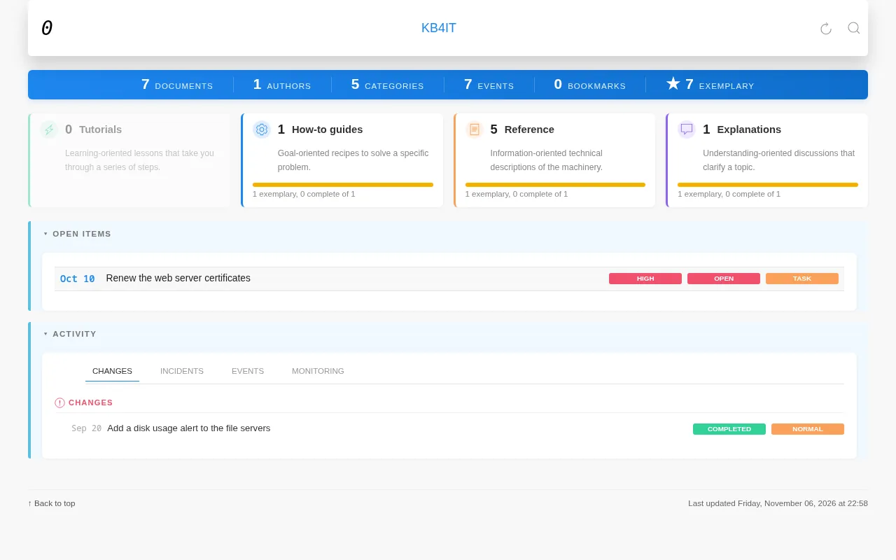

A document page shows the quality score, the main properties and the tabs with details, quality, related documents and history above the text.

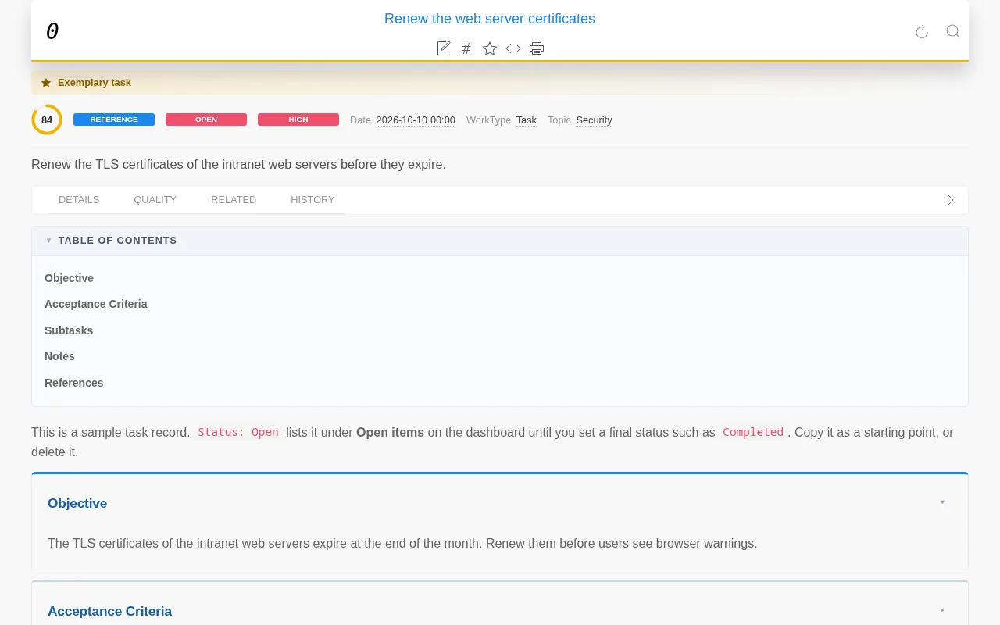

Every property value has its own page. An author with a profile gets the profile card above the table of their documents.

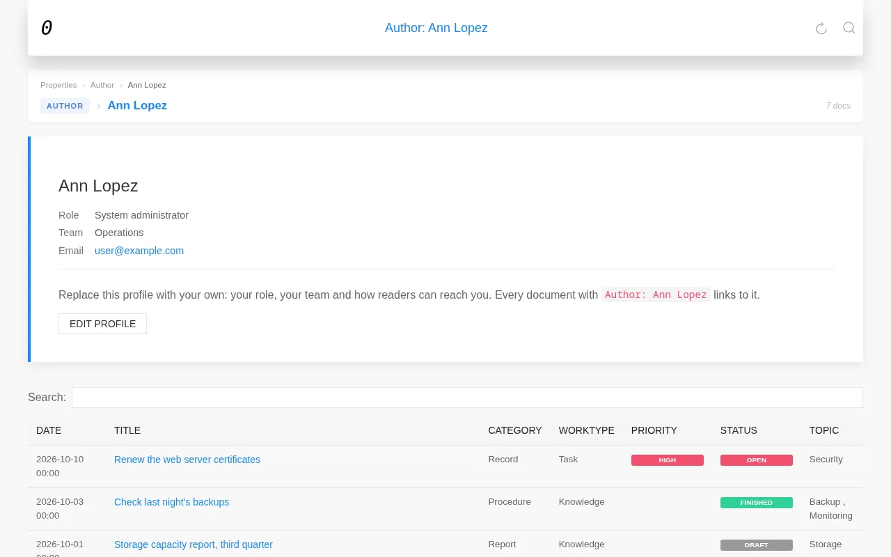

The Add page writes new documents in the browser, from a skeleton for each kind of document; see [Write in the editor](howto-write-document-editor.md).

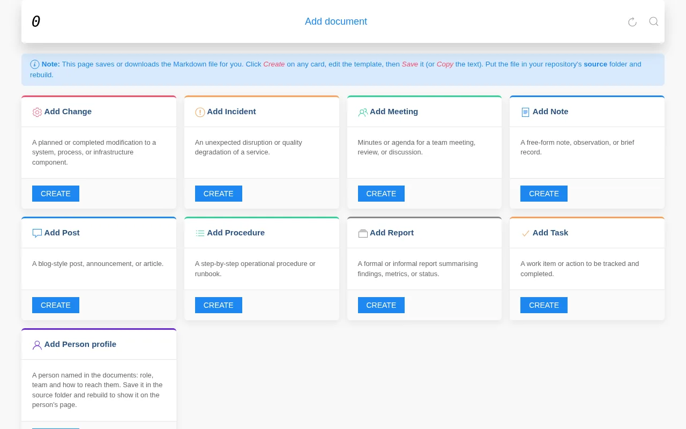

## blog {#blog}

The home page lists the latest posts with their excerpt.

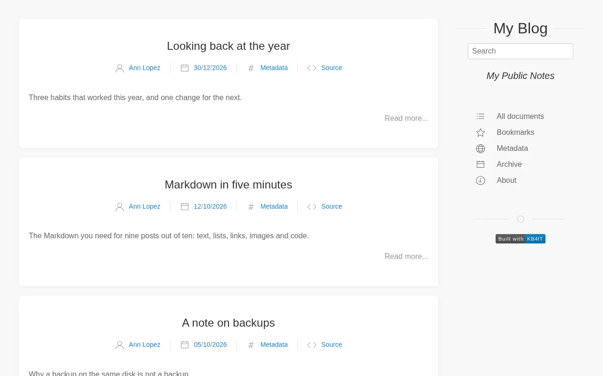

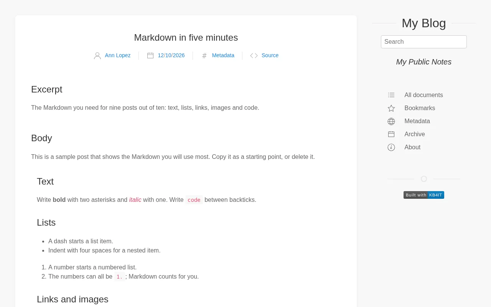

## bookshelf {#bookshelf}

The library shows every book on a shelf, with the reading progress and the chapter to continue.

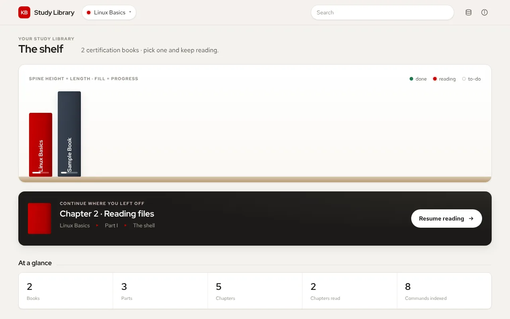

A book page shows its parts as columns, with the state of each chapter.

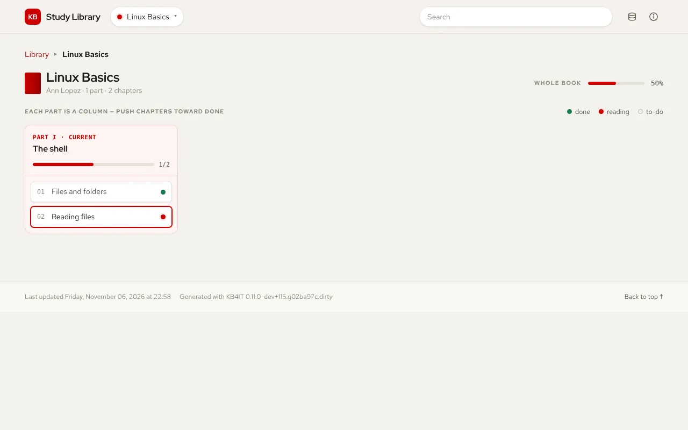

## apphelp {#apphelp}

This help is an apphelp site. It follows the light or dark setting of the system.

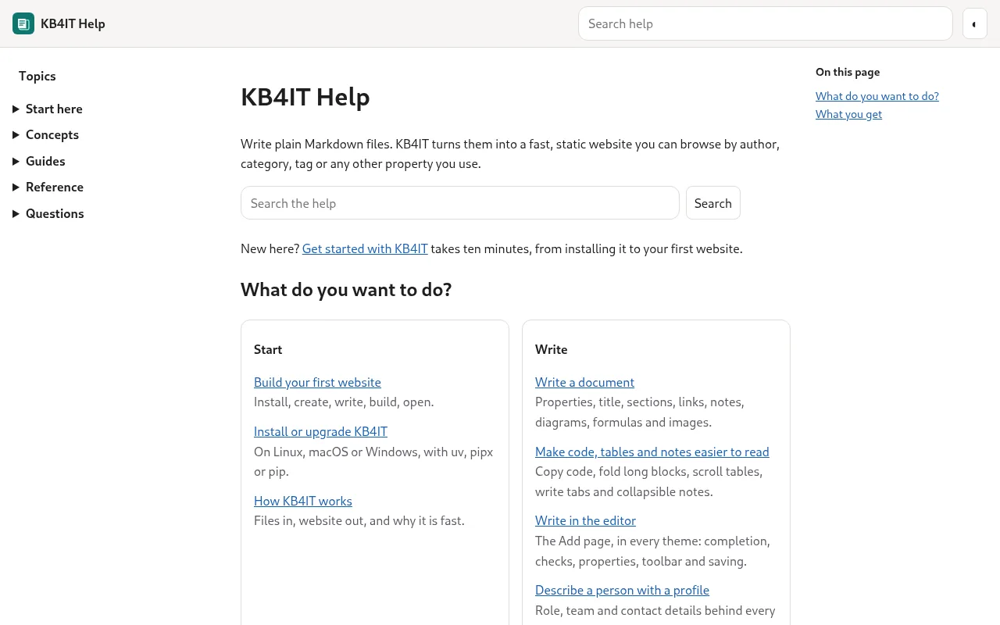

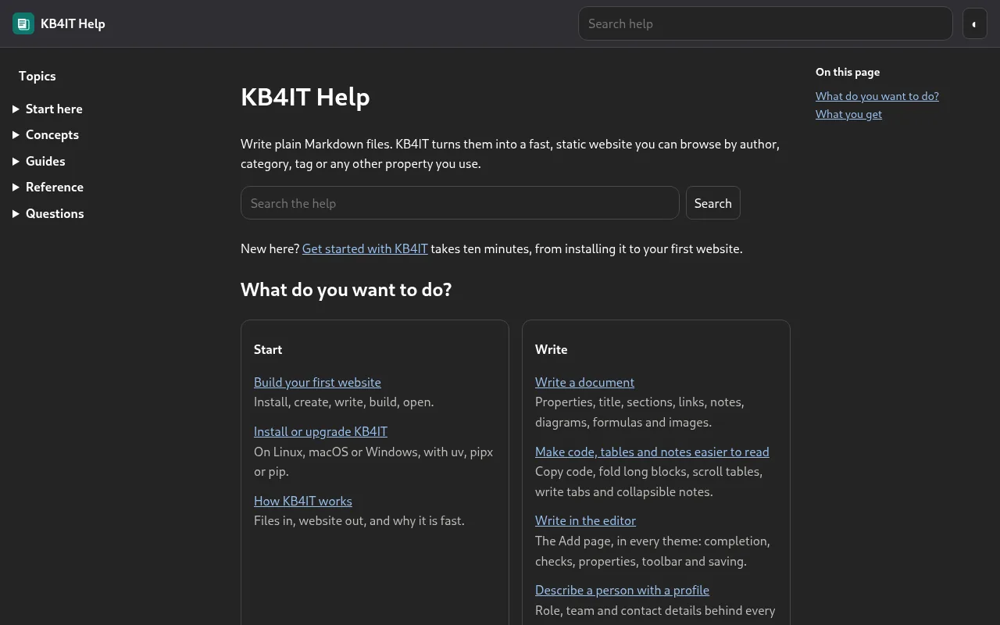

## Terminal interface {#tui}

Run `kb4it` with no arguments in a terminal; see [Use the terminal interface](howto-use-tui.md).

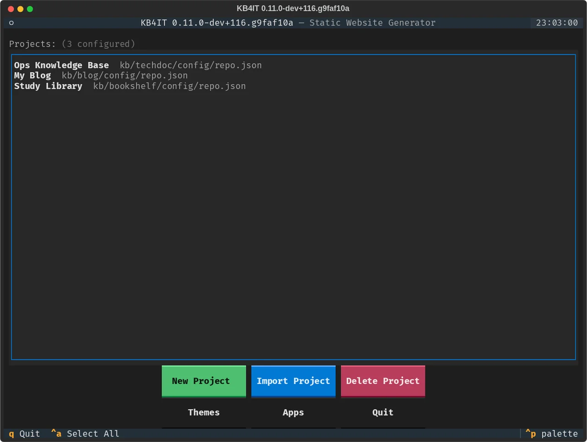

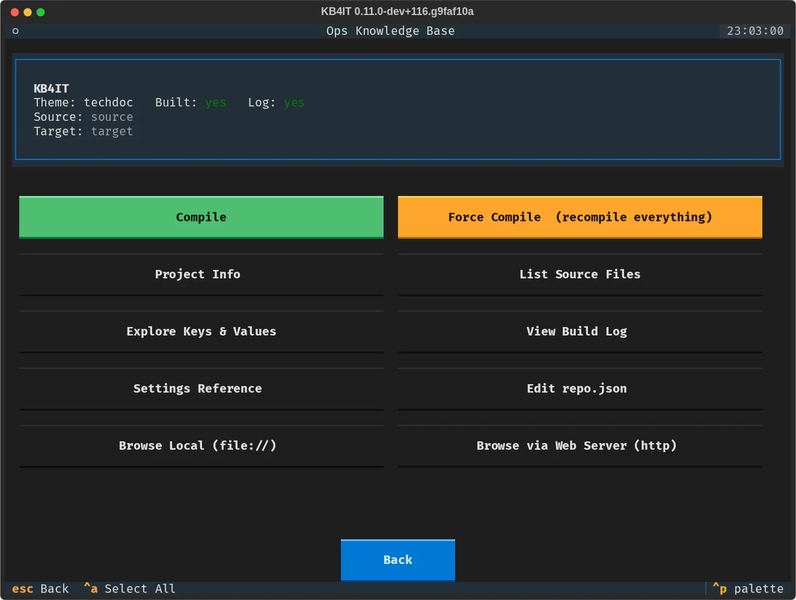

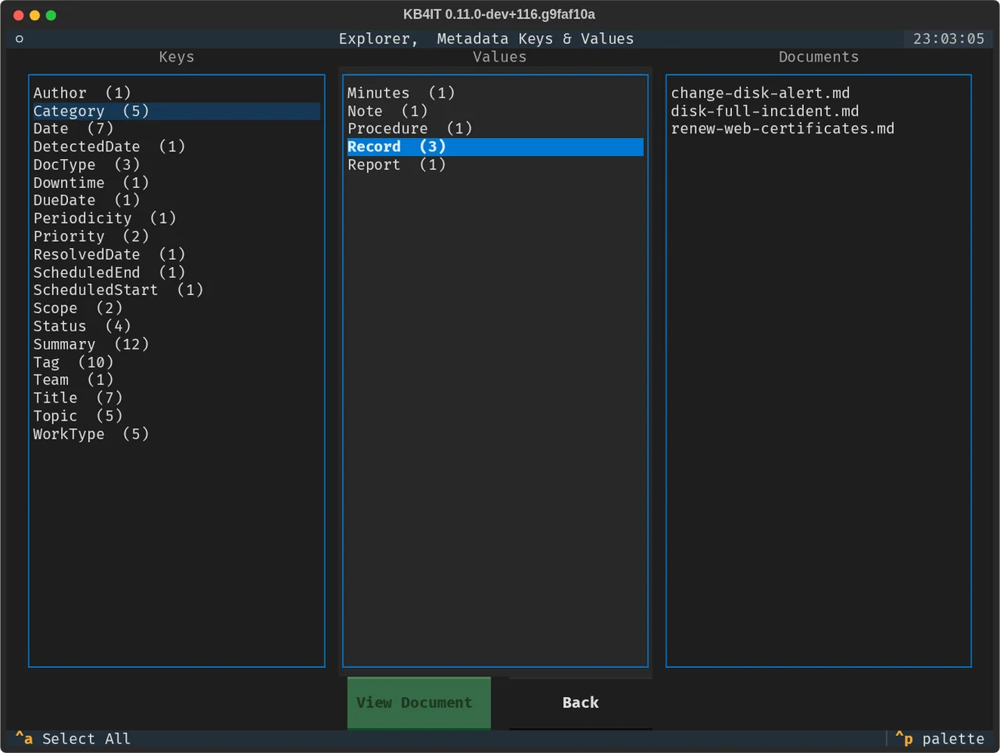
