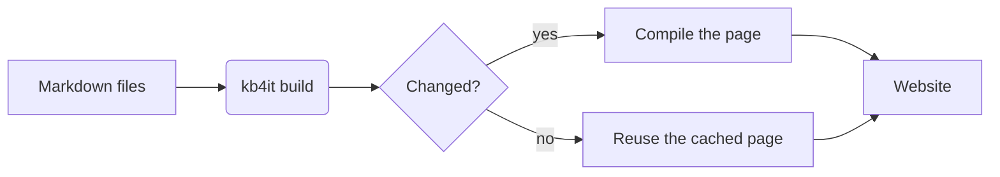
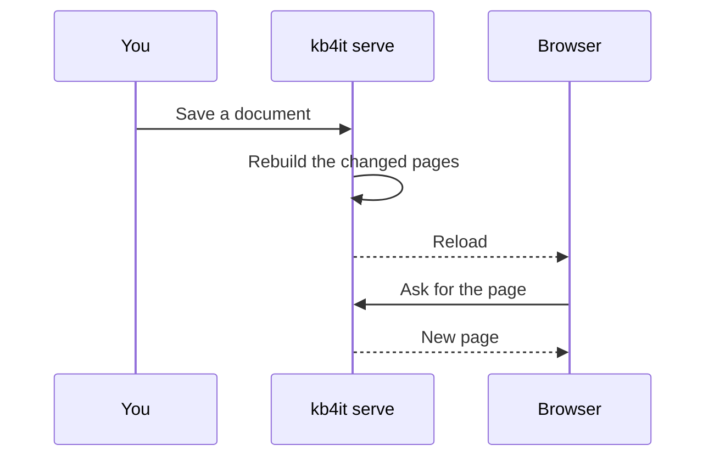
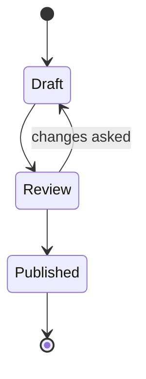
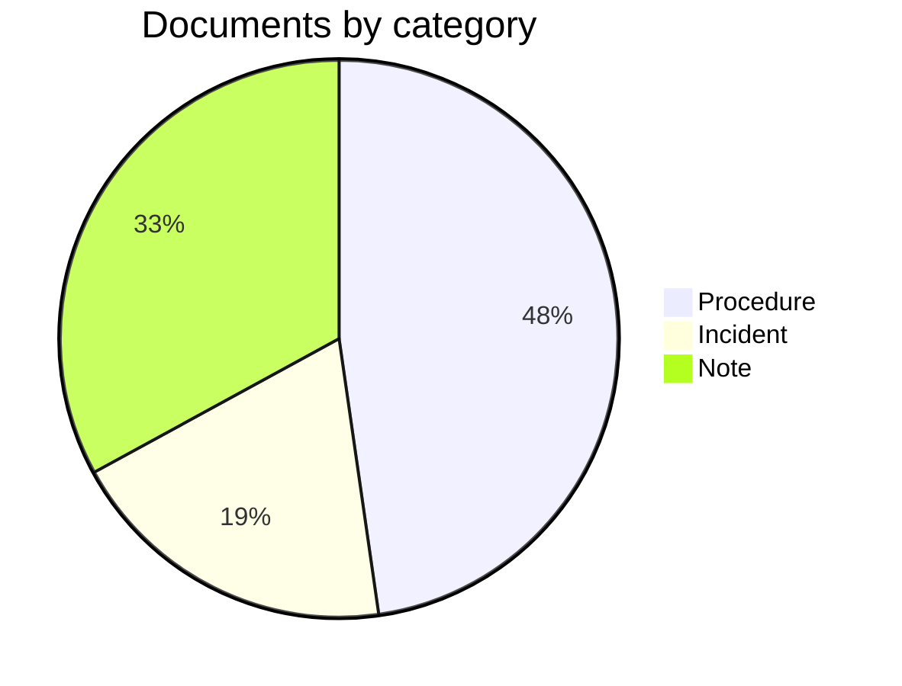

# Diagram and formula gallery

Each example shows the Markdown you write, then the result as readers see it. Copy the source into a document and change it. The rules are in [Document format](reference-document-format.md#formulas); how to start is in [Write a document](howto-write-documents.md#diagrams).

Diagrams are drawn by [Mermaid](https://mermaid.js.org/) and formulas by [KaTeX](https://katex.org/), in the browser. Both ship with KB4IT, so the pages work offline and when opened from disk.

## Flowchart {#flowchart}

````markdown

````


## Sequence diagram {#sequence}

````markdown

````


## State diagram {#state}

````markdown

````


## Pie chart {#pie}

````markdown

````


## Inline formula {#inline}

````markdown
A circle of radius $r$ has the area $A = \pi r^2$, and $e^{i\pi} + 1 = 0$.
````

A circle of radius $r$ has the area $A = \pi r^2$, and $e^{i\pi} + 1 = 0$.

## Display formula {#display}

````markdown
$$
\int_0^1 x^2\,dx = \frac{1}{3}
$$
````

$$
\int_0^1 x^2\,dx = \frac{1}{3}
$$

## Sums and limits {#sums}

````markdown
$$
\sum_{k=1}^{n} k = \frac{n(n+1)}{2} \qquad \lim_{x \to 0} \frac{\sin x}{x} = 1
$$
````

$$
\sum_{k=1}^{n} k = \frac{n(n+1)}{2} \qquad \lim_{x \to 0} \frac{\sin x}{x} = 1
$$

## Matrix {#matrix}

````markdown
$$
A = \begin{pmatrix} 1 & 2 \\ 3 & 4 \end{pmatrix}, \quad \det A = -2
$$
````

$$
A = \begin{pmatrix} 1 & 2 \\ 3 & 4 \end{pmatrix}, \quad \det A = -2
$$

## Aligned equations {#aligned}

````markdown
$$
\begin{aligned}
(a + b)^2 &= a^2 + 2ab + b^2 \\
(a - b)^2 &= a^2 - 2ab + b^2
\end{aligned}
$$
````

$$
\begin{aligned}
(a + b)^2 &= a^2 + 2ab + b^2 \\
(a - b)^2 &= a^2 - 2ab + b^2
\end{aligned}
$$

## Cases {#cases}

````markdown
$$
|x| = \begin{cases} x & \text{if } x \ge 0 \\ -x & \text{if } x < 0 \end{cases}
$$
````

$$
|x| = \begin{cases} x & \text{if } x \ge 0 \\ -x & \text{if } x < 0 \end{cases}
$$

## Formula in a list {#list}

````markdown
- Disk use, in per cent: $\frac{used}{size} \times 100$
- Free space: $size - used$
````

- Disk use, in per cent: $\frac{used}{size} \times 100$
- Free space: $size - used$

## A dollar sign as text {#dollar}

````markdown
The licence costs \$5 per seat, or `$5` in code.
````

The licence costs \$5 per seat, or `$5` in code.
