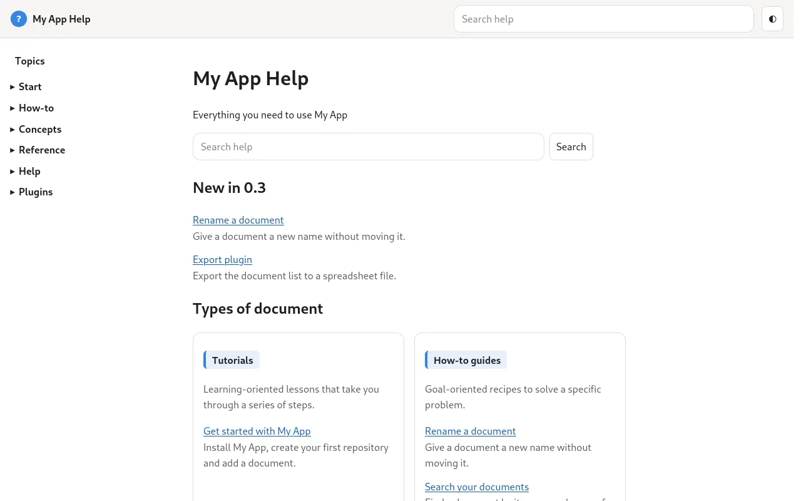

# apphelp

apphelp builds the help of an application, like the site you are reading. The same files work opened from disk, on a web server under any path such as GitHub Pages, and inside the application.



## What you get {#features}

- A sidebar of sections, built from the pages' `Section` and `Order`.
- Search that runs in the browser, with filters, and needs no server.
- Versions: one folder per release of your application, with a version selector; see [versions](#versions).
- A **Topics** page listing pages by feature.
- Help ids: the application opens `go.html?id=rename` and lands on the right page or section.
- `?embed=1` hides the header and sidebar, for a help viewer inside the application.
- The icon of the browser tab is `logo` from `repo.json`; without it, the theme's own logo.
- [Mermaid diagrams and formulas](reference-document-format.md#diagrams) in pages.
- A `404.html` page for missing addresses, in every build.
- Strict checks: a page with a missing or unknown property fails the build, so the help never ships half written.

## Page properties {#properties}

| Key | Required | Meaning |
|---|---|---|
| `DocType` | yes | `Tutorial`, `How-to guide`, `Reference` or `Explanation`; a page without it is left out |
| `Section` | yes | Sidebar group |
| `Order` | yes | Position in the section; sections follow their lowest `Order` |
| `Summary` | yes | One sentence, at most 160 characters, for search results and lists |
| `Feature` | yes | One or more values from the `Feature` vocabulary |
| `Layout` | no | `faq`, `tips` or `troubleshooting`, see below |
| `HelpId` | no | Ids the application opens with `go.html?id=<id>` |
| `Keyword` | no | Words readers search for that the text does not use |
| `Level` | no | From the `Level` vocabulary |
| `Platform` | no | One or more platforms the page applies to; each value is shown as a chip under the title and offered as a search filter. Checked against the `Platform` vocabulary when `repo.json` defines one |
| `Since` | no | Version that introduced the feature; pages for the current version are listed as new |
| `Plugin` | no | Plugin the page belongs to; shown under the title as "Plugin: name" and offered as a search filter. Only the first value is used, and it is not checked against a vocabulary |
| `Related` | no | Pages listed first under **Related pages** |

`index.md` is the home page and needs none of them. `search.md`, `topics.md`, `go.md` and `404.md` are reserved.

## Layouts {#layouts}

| `Layout` | Each `##` heading becomes |
|---|---|
| `faq` | A question that opens on click |
| `tips` | A card |
| `troubleshooting` | A problem, with `### Cause` and `### Fix` styled |

Tutorials number their `##` steps by themselves.

## Settings {#settings}

The `apphelp` block of `repo.json`:

```json
"apphelp": {
    "strict": true,
    "lang": "en",
    "accent": "#0f766e",
    "about": false,
    "contract": "config/contract.txt",
    "vocabulary": {
        "Feature": ["Getting started", "Documents", "Settings"],
        "Level": ["basic", "advanced"]
    }
}
```

| Key | Meaning |
|---|---|
| `strict` | `true` by default: metadata problems and help ids pointing nowhere fail the build |
| `lang` | Language of the pages |
| `accent` | Accent colour |
| `about` | `true` adds an about page |
| `contract` | A file listing, one per line, the help ids and anchors the application opens; a missing one fails the build |
| `vocabulary` | Allowed values per property |
| `labels` | Your own texts for the interface |
| `versions` | `{"enabled": true}` keeps one folder per version of the help; see [versions](#versions) |

Edit links use `"git": true` and `git_server` without `https://`, for example `github.com`.

## Versions {#versions}

An application often needs the help of each release. Turn on versions in the `apphelp` block and name the version with the top-level `version` key:

```json
"version": "2.1",
"apphelp": {"versions": {"enabled": true, "latest": "2.1"}}
```

Each build then writes into `target/<version>/` and leaves the other version folders alone. At the top of `target/` it keeps:

| File | Purpose |
|---|---|
| `latest/` | A copy of the newest version (or of `latest`, when set), so links to `latest/` always work |
| `index.html` | Sends readers to `latest/` |
| `versions.json`, `versions.js` | The versions and their pages; `versions.js` lets the switcher work from disk |
| `helpids.js` | The help ids of the latest version, for applications that open help by id |

With two or more versions, a version selector appears in the header. It opens the same page in the chosen version, or that version's start page when the page does not exist there.

To publish all versions on GitHub Pages, see [Publish versioned help](howto-publish-github-pages.md#versions).

## Start a help site {#start}

```bash
kb4it create apphelp myapp/help
```

The sample shows every page type. Use `kb4it verify myapp/help/config/repo.json` while writing: it reports every page that breaks a rule. The help of [MiAZ](https://t00m.github.io/MiAZ/) and this site are built with apphelp; their sources are good examples.
