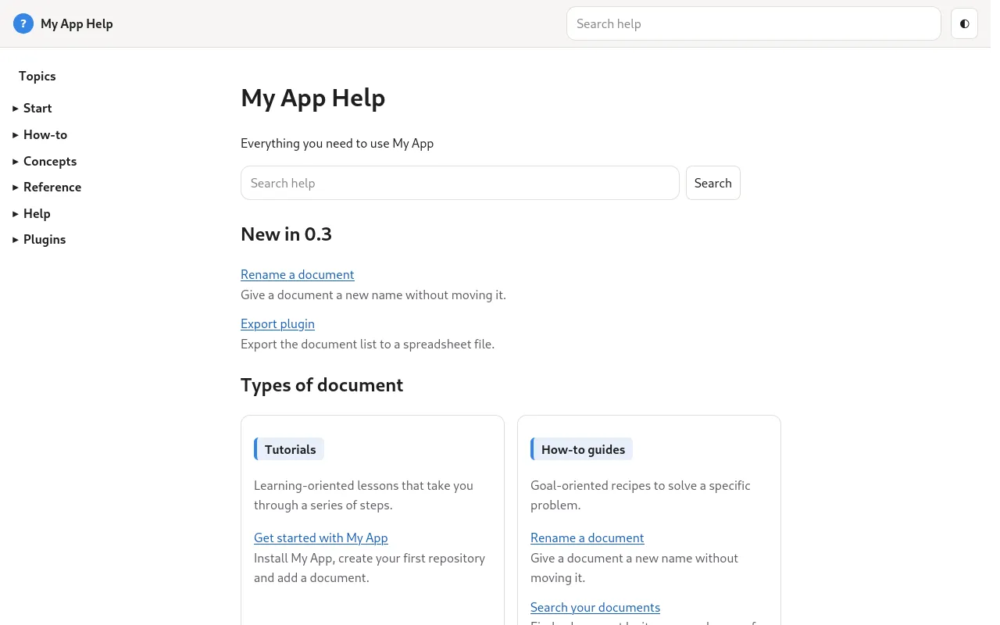

# apphelp

apphelp builds the help of an application, like the site you are reading. The same files work opened from disk, on a web server under any path such as GitHub Pages, and inside the application.



## What you get {#features}

- A sidebar of sections, built from the pages' `Section` and `Order`.
- Search that runs in the browser, with filters, and needs no server.
- Versions: one folder per release of your application, with a version selector; see [versions](#versions).
- A **Topics** page listing pages by feature.
- An optional Add page with a Markdown editor, off by default; see [Add page and editor](#editor).
- Help ids: the application opens `go.html?id=rename` and lands on the right page or section.
- `?embed=1` hides the header and sidebar, for a help viewer inside the application.
- The icon of the browser tab is `logo` from `repo.json`; without it, the theme's own logo.
- [Mermaid diagrams and formulas](reference-document-format.md#diagrams) in pages.
- A `404.html` page for missing addresses, in every build.
- Strict checks: a page with a missing or unknown property fails the build, so the help never ships half written.

## Page properties {#properties}

| Key | Required | Meaning |
|---|---|---|
| `DocType` | yes | `Tutorial`, `How-to guide`, `Reference` or `Explanation`; a page without it is left out |
| `Section` | yes | Sidebar group |
| `Order` | yes | Position in the section; sections follow their lowest `Order` |
| `Summary` | yes | One sentence, at most 160 characters, for search results and lists |
| `Feature` | yes | One or more values from the `Feature` vocabulary |
| `Layout` | no | `faq`, `tips` or `troubleshooting`, see below |
| `HelpId` | no | Ids the application opens with `go.html?id=<id>` |
| `Keyword` | no | Words readers search for that the text does not use |
| `Level` | no | From the `Level` vocabulary |
| `Platform` | no | One or more platforms the page applies to; each value is shown as a chip under the title and offered as a search filter. Checked against the `Platform` vocabulary when `repo.json` defines one |
| `Since` | no | Version that introduced the feature; pages for the current version are listed as new |
| `Plugin` | no | Plugin the page belongs to; shown under the title as "Plugin: name" and offered as a search filter. Only the first value is used, and it is not checked against a vocabulary |
| `Related` | no | Pages listed first under **Related pages** |

`index.md` is the home page and needs none of them. `search.md`, `topics.md`, `go.md` and `404.md` are reserved.

## Layouts {#layouts}

| `Layout` | Each `##` heading becomes |
|---|---|
| `faq` | A question that opens on click |
| `tips` | A card |
| `troubleshooting` | A problem, with `### Cause` and `### Fix` styled |

Tutorials number their `##` steps by themselves.

## Settings {#settings}

The `apphelp` block of `repo.json`:

```json
"apphelp": {
    "strict": true,
    "lang": "en",
    "accent": "#0f766e",
    "about": false,
    "contract": "config/contract.txt",
    "vocabulary": {
        "Feature": ["Getting started", "Documents", "Settings"],
        "Level": ["basic", "advanced"]
    }
}
```

| Key | Values | Default | Meaning |
|---|---|---|---|
| `strict` | `true`, `false` | `true` | Metadata problems and help ids pointing nowhere fail the build |
| `lang` | Language tag, such as `en`, `es` or `pt-BR` | `seo.lang`, else `en` | Language of the pages; without it, `seo.lang` of [repo.json](reference-repo-json.md#seo), else `en` |
| `accent` | Hex colour: `#rgb`, `#rgba`, `#rrggbb` or `#rrggbbaa` | `#3584e4` | Accent colour; any other value falls back to the default |
| `about` | `true`, `false` | `false` | `true` adds an about page |
| `contract` | File path | `config/contract.txt` | A file listing, one per line, the help ids and anchors the application opens; a missing one fails the build |
| `vocabulary` | Object: property name to list of values | `{}` | Allowed values per property. `Feature` is required while `strict` is on; `Level` and `Platform` are checked only when listed |
| `labels` | Object: label name to text | English texts | Your own texts for the interface, see below |
| `versions.enabled` | `true`, `false` | `false` | Keeps one folder per version of the help; see [versions](#versions) |
| `versions.latest` | A version | the highest version | Version the site root and `latest/` point to |
| `version` | Text, or `"kb4it"` for the installed KB4IT version | | Top-level key of `repo.json`, not of the `apphelp` block. Version of the application the help describes; see [versions](#versions) |
| `editor` | `true`, `false` | `false` | Top-level key of `repo.json`, not of the `apphelp` block. `true` builds `add.html` and the **Add a page** link in the sidebar; see [Add page and editor](#editor) |
| `git` | `true`, `false` | `false` | Top-level key of `repo.json`, not of the `apphelp` block. Edit links; they need `git_server`, `git_user`, `git_repo` and `git_branch` |
| `git_server` | Host name without scheme, such as `github.com` | | Top-level key of `repo.json`, not of the `apphelp` block. Git server of the edit links; KB4IT adds `https://` |
| `git_user` | Text | | Top-level key of `repo.json`, not of the `apphelp` block. User or organisation on the git server |
| `git_repo` | Text | | Top-level key of `repo.json`, not of the `apphelp` block. Repository name |
| `git_branch` | Text | | Top-level key of `repo.json`, not of the `apphelp` block. Branch the edit links open |
| `git_path` | Folder path inside the repository | | Top-level key of `repo.json`, not of the `apphelp` block. Folder that holds the pages; empty for the repository root |

The `labels` object renames the texts of the interface. Besides the labels for the search, the sidebar and the types of document, `add` sets the sidebar link to the Add page (default "Add a page"). Unknown label names are ignored. The label names are `home`, `menu`, `breadcrumb`, `search`, `search_placeholder`, `filters`, `results`, `no_results`, `topics`, `add`, `topics_intro`, `on_this_page`, `previous`, `next`, `related`, `edit`, `updated`, `built_with`, `theme_toggle`, `skip`, `new_in`, `plugin`, `copy`, `copied`, `go_title`, `go_unknown`, `not_found_title`, `not_found_text`, `ts_cause`, `ts_fix`, `doctypes`, `doctype_tutorial`, `doctype_howto`, `doctype_reference`, `doctype_explanation`, `doctype_tutorial_title`, `doctype_howto_title`, `doctype_reference_title`, `doctype_explanation_title`, `doctype_tutorial_desc`, `doctype_howto_desc`, `doctype_reference_desc`, `doctype_explanation_desc`, `facet_DocType`, `facet_Feature`, `facet_Level`, `facet_Platform`, `facet_Plugin` and `facet_Since`.

## Add page and editor {#editor}

Set `"editor": true` in `repo.json` (not in the `apphelp` block) to build `add.html`, a page with a Markdown editor for new documents. The sidebar then shows the `add` label ("Add a page") under **Topics**. While the editor is on, `add.md` is a reserved source name: the build reports `DOC_NAME_RESERVED` and `kb4it verify` lists it as `reserved_name`. With the key missing or `false`, the page and the link are not built, and an `add.html` left by an earlier build is removed. With versions on, the page and the editor files go into the version folder like the other pages.

The page offers four skeletons, one per type of document: `TUTORIAL`, `HOWTO`, `REFERENCE` and `EXPLANATION`. Each one sets `DocType` and has empty `Section`, `Order`, `Summary`, `Feature` and `Level`. apphelp ignores the `icon` field of `skeletons.json`. Replace them with `templates/skeletons/` in the repository overrides; see [Write a document in the editor](howto-write-document-editor.md).

Completion and the Properties form offer the values of the documents plus the allowed ones that no document uses yet: the `vocabulary` lists, the four `DocType` names and the `Layout` names. `Section`, `Order` and `Summary` are free text. The editor does not check apphelp's rules; `kb4it verify` and the build do.

Edit links use `"git": true` and `git_server` without `https://`, for example `github.com`.

## Versions {#versions}

An application often needs the help of each release. Turn on versions in the `apphelp` block and name the version with the top-level `version` key:

```json
"version": "2.1",
"apphelp": {"versions": {"enabled": true, "latest": "2.1"}}
```

Each build then writes into `target/<version>/` and leaves the other version folders alone. At the top of `target/` it keeps:

| File | Purpose |
|---|---|
| `latest/` | A copy of the newest version (or of `latest`, when set), so links to `latest/` always work |
| `index.html` | Sends readers to `latest/` |
| `versions.json`, `versions.js` | The versions and their pages; `versions.js` lets the switcher work from disk |
| `helpids.js` | The help ids of the latest version, for applications that open help by id |

With two or more versions, a version selector appears in the header. It opens the same page in the chosen version, or that version's start page when the page does not exist there.

To publish all versions on GitHub Pages, see [Publish versioned help](howto-publish-github-pages.md#versions).

## Start a help site {#start}

```bash
kb4it create apphelp myapp/help
```

The sample shows every page type. Use `kb4it verify myapp/help/config/repo.json` while writing: it reports every page that breaks a rule. The help of [MiAZ](https://t00m.github.io/MiAZ/) and this site are built with apphelp; their sources are good examples.
