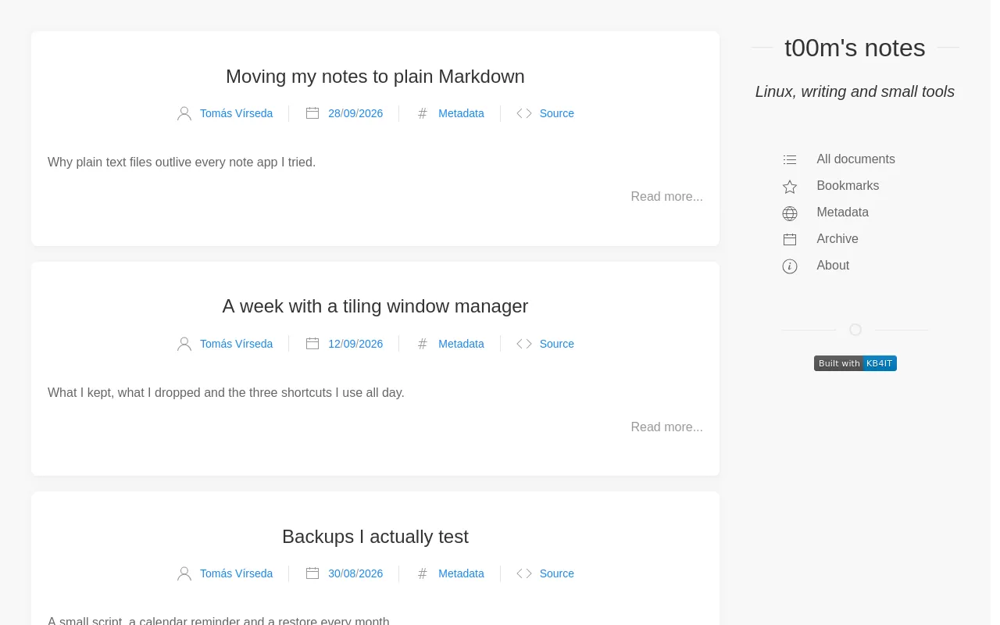

# blog

blog publishes your documents as posts, newest first, with an excerpt on the home page and an archive by date.



## Write a post {#post}

```markdown
---
Author: Ann Lopez
Category: Post
Date: 2026-09-28
Tag: markdown, notes
---

# Moving my notes to plain Markdown

## Excerpt

Why plain text files outlive every note app I tried.

## Body

The full text...
```

- The home page shows the text of the `## Excerpt` section and a **Read more** link. A post without one shows "Excerpt missing".
- `Date` orders the posts and places them in the archive.
- The author and date are shown under the title when the post has them.

## Pages {#pages}

| Page | Shows |
|---|---|
| `index.html` | The newest posts with their excerpts |
| `events.html` | The archive, by year and month |
| `all.html` | Every document in a table |
| `bookmarks.html` | Documents with `Bookmark: Yes` |
| `properties.html` | Every property and its values |
| `stats.html` | A tag cloud of the values |
| `feed.xml` | Atom feed of the newest posts, when `site_url` is set; see [feed](reference-repo-json.md#feed) |
| `search.html` | Full-text search over every document, with filters by Category, WorkType and Tag; the search box in the sidebar shows the best matches as you type. See [search](reference-repo-json.md#search) |
| `add.html` | Markdown editor for a new post; only when `"editor": true` is set in `repo.json`. The footer then shows an "Add document" link. See [the editor](howto-write-document-editor.md) |
| `404.html` | "Page not found", in the theme's layout, with a link home and the search box. A web server shows it for a missing address; see [serving it](howto-publish-web-server.md#not-found). A document named `404.md` is left out with `DOC_NAME_RESERVED` |

## Icon, diagrams and formulas {#render}

- The icon of the browser tab is `logo` from `repo.json`; without it, the theme's own logo (`images/logo.svg`).
- Documents can hold [Mermaid diagrams and formulas](reference-document-format.md#diagrams).

## Settings {#settings}

| Key | Default | Meaning |
|---|---|---|
| `index_posts` | `10` | Number of posts on the home page |
| `strict` | `false` | When `true`, only `Category: Post` documents use the post layout; other documents use a plain page |
| `editor` | `false` | `true` builds the Add page. The skeleton is `POST-SKELETON.md` (`Author`, `Category: Post`, `Date`, `Tag`, `Topic`, an `## Excerpt` and a `## Body`); put your own in `templates/skeletons/` of the repository overrides to replace it |
| `datatable` | | Columns of the document tables; the `default` app uses Date, Title and Topic |
| `git`, `git_server`, `git_user`, `git_repo`, `git_branch`, `git_path` | | Edit links; `git_server` is a full URL such as `https://github.com` |

The `default` app has four sample posts, each with an `## Excerpt` and a `## Body`.

See also the [common settings](reference-repo-json.md).
