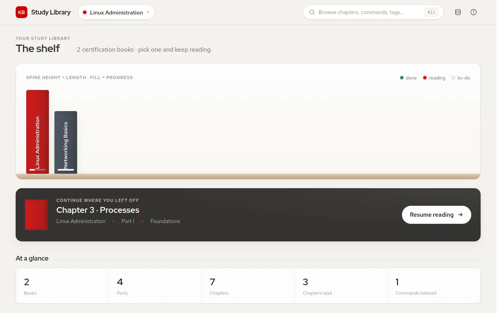
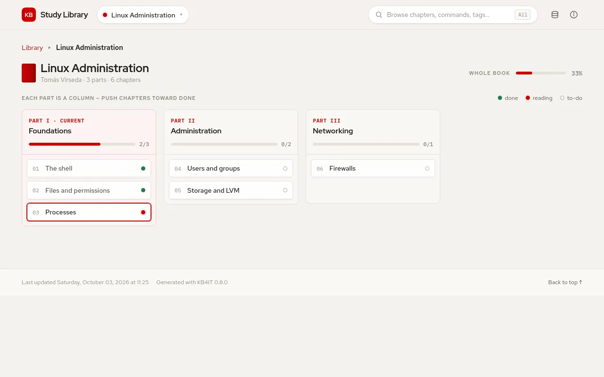

# bookshelf

bookshelf arranges your notes as books on a shelf. Each document is a chapter; the theme tracks what you have read and takes you back to where you stopped.



## Write a chapter {#chapter}

```markdown
---
Book: Linux Administration
Part: II
PartTitle: Administration
Chapter: 5
Status: Reading
Command: lvcreate, vgextend
---

# Storage and LVM
```

| Property | Meaning |
|---|---|
| `Book` | The book the chapter belongs to; chapters without one go to **Unfiled** |
| `Part` | Part number, in Roman (`II`) or Arabic (`2`) numerals |
| `PartTitle` | Name of the part, shown in the book overview |
| `Chapter` | Chapter number; `5` and `Chapter 5` both work |
| `Status` | Reading progress, see below |
| `Command` | Commands the chapter teaches; they get their own pages |

Chapters are ordered by part, then by chapter number.

## Reading progress {#status}

| `Status` | Counts as |
|---|---|
| `Done`, `Completed`, `Complete`, `Published`, `Closed`, `Final` | done |
| `Reading`, `In progress`, `Review`, `WIP`, `Ongoing` | reading |
| anything else, or none | to do |

Case does not matter. The shelf shows the progress of each book, and **Continue where you left off** opens the first chapter marked as reading; without one, the latest chapter that is not done.

## Pages {#pages}



| Page | Shows |
|---|---|
| `index.html` | The shelf, the chapter to continue and totals; your own `index.md` replaces it |
| `Book_<name>.html` | The book overview: one column per part, one card per chapter |
| Chapter pages | Navigation through the part, previous and next chapter, commands and tags |
| `all.html`, `bookmarks.html`, `properties.html`, `stats.html` | As in the other themes |
| `search.html` | Full-text search over every document, with filters by Category and Tag; the search box in the top bar (it replaces the link to `all.html`) shows the best matches as you type. See [search](reference-repo-json.md#search) |
| `add.html` | Markdown editor for a new chapter; only when `"editor": true` is set in `repo.json`. The top bar then shows a plus button titled "Add document". See [the editor](howto-write-document-editor.md) |
| `404.html` | "Page not found", in the theme's layout, with a link home and the search box. A web server shows it for a missing address; see [serving it](howto-publish-web-server.md#not-found). A document named `404.md` is left out with `DOC_NAME_RESERVED` |

## Icon, diagrams and formulas {#render}

- The icon of the browser tab is `logo` from `repo.json`; without it, the theme's own logo (`images/logo.svg`).
- Documents can hold [Mermaid diagrams and formulas](reference-document-format.md#diagrams).
- Fonts: the theme downloads none. It uses Red Hat Display, Red Hat Text and IBM Plex Mono when they are installed on the reader's computer (Fedora and RHEL ship the Red Hat fonts), and the system's own fonts otherwise. Pages look slightly different from one system to another.

## Settings {#settings}

| Key | Default | Meaning |
|---|---|---|
| `editor` | `false` | `true` builds the Add page. The skeleton is `CHAPTER-SKELETON.md` (`Author`, `Book`, `Part`, `Chapter`, `Date`, `Status`); put your own in `templates/skeletons/` of the repository overrides to replace it |
| `datatable` | `["Date", "Title", "Chapter"]` | Columns of the document tables |
| `git`, `git_server`, `git_user`, `git_repo`, `git_branch`, `git_path` | | Edit links; `git_server` is a full URL such as `https://github.com` |

See also the [common settings](reference-repo-json.md).
