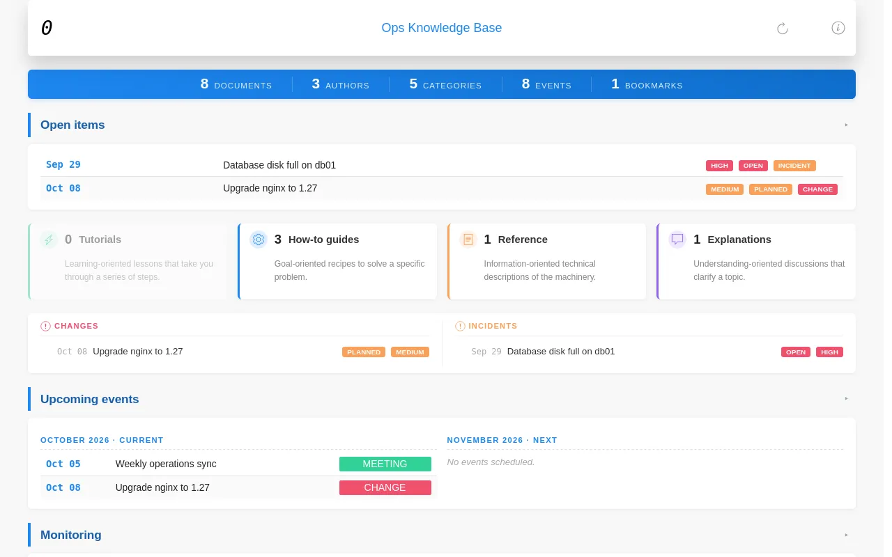
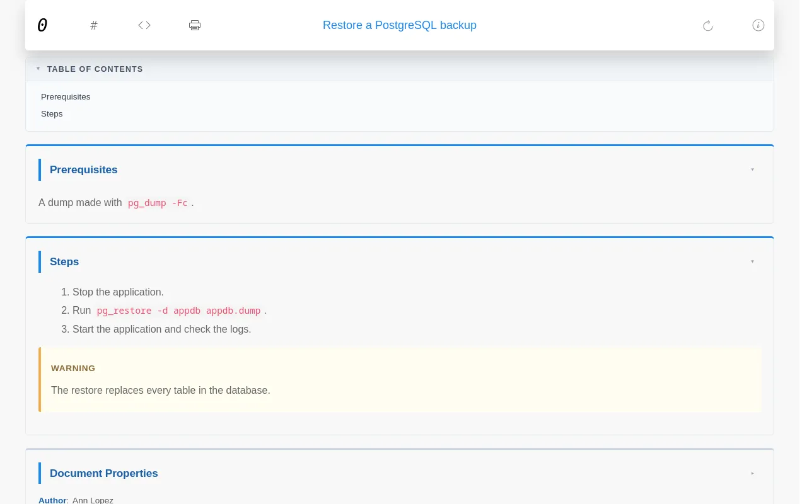

# techdoc

techdoc turns a folder of runbooks, incident reports, changes and notes into a team knowledge base with a dashboard.

## Properties it reacts to {#properties}

| Property | Values | Effect |
|---|---|---|
| `Category` | `Change`, `Incident`, `Meeting`, `Note`, `Post`, `Procedure`, `Report`, `Task` | Groups documents; dated documents of the categories in `events` appear in the calendar |
| `DocType` | `Tutorial`, `How-to guide`, `Reference`, `Explanation` | Counted in the four cards of the dashboard |
| `Priority` | `Critical`, `Very high`, `High`, `Medium`, `Normal`, `Low`, `Unknown` | Coloured label; open items are sorted by it |
| `Status` | Open: `New`, `Open`, `Draft`, `Planned`. Closed: `Completed`, `Finished`, `Released`, `Successful`. Faded: `Deprecated`, `Obsolete` | Coloured label; open values put incidents, changes and tasks under **Open items** |
| `Topic` + `Periodicity` | `Topic: Monitoring` with `Periodicity: Daily`, `Weekly`, ... | Listed in the **Monitoring** panel by periodicity |
| `Bookmark` | `Yes` | Listed on the **Bookmarks** page |
| `Date` | any [date](reference-document-format.md#dates) | Sorting, calendar, upcoming and recent events |

Any other property gets its own pages, as in every theme.

## Dashboard {#dashboard}

The home page shows, from top to bottom:

- Counts of documents, authors, categories, events and bookmarks.
- The four types of document, with counts.
- **Open items**: incidents, changes and tasks with an open status, highest priority first.
- The latest changes and incidents.
- **Upcoming events** for this month and the next, and recent events from the last month.
- **Monitoring**: recurring checks grouped by periodicity.

Every section except the counts and the four document types folds when you click its title. The browser remembers which sections you folded.

## Document pages {#document}

The top bar holds the logo menu on the left, the page title in the middle and a search icon on the right:

- The logo menu links to the dashboard (click the logo), the Add page, Events, Bookmarks, Properties, Stats, Reload page, Help, About this app and About KB4IT.
- A long title ends in an ellipsis; hover over it to read it whole. On a document, hovering over the title opens the title menu: one row of buttons at the top (edit with `"git": true`, document properties, document source, print), then the table of contents.
- The search icon, `/` or `Ctrl+K` opens the search dialog, which shows the best matches as you type. The keys do nothing while you type in a field.

Each document gets a table of contents, sections that fold when you click their heading, and buttons in the title menu to show the properties and the Markdown source and to print. Every heading level folds. The table of contents and the first section start open; the other top-level sections start folded, and their subsections open with them. A link to a section, from the table of contents or another page, unfolds it. Printing shows every section, and each printed page (documents and the other techdoc pages) ends with the page title on the left and the page number (`3/8`) on the right. The footer needs a browser that supports CSS page-margin boxes, such as Chrome or Edge; turn off the browser's own headers and footers in the print dialog to avoid a second footer. With `"git": true`, an edit button opens the file in your git server. Documents that other documents link to end with a **Linked from** list.

## Add page and editor {#editor}

`add.html` writes new documents in a Markdown editor (CodeMirror 6, bundled, no network). Click **Create** on a category card to open its skeleton. The page is built by KB4IT itself and follows the `editor` setting of `repo.json`, which is on by default for techdoc. The cards come from `templates/skeletons/skeletons.json`; a repository can replace them with its own `overrides/templates/skeletons/` folder. For a walk-through see [Write a document in the editor](howto-write-document-editor.md).

| Part | What it does |
|---|---|
| Editor | Line numbers, Markdown and frontmatter highlighting, undo, search (`Ctrl+F`), lists and quotes continued on Enter. Tab indents (four spaces), Shift-Tab outdents, `Escape` then `Tab` leaves the editor |
| Completion | In the frontmatter: property names, and values of the repository, most used first. Values that YAML needs quoted are quoted |
| Lint | A gutter with the diagnostics below |
| Properties pane | One row per property: value chips, suggestions with counts, a property selector with "New property...", and a word cloud per property |
| Toolbar | Bold, italic, code, link, headings H2 to H4, lists, quote, code block, rule, table, image, admonitions, Mermaid diagram, formulas. Disabled while the cursor is in the frontmatter |
| Save and Copy | Save a file or download it; Copy writes the text to the clipboard |

On open, the text of the H1 title is selected, so typing replaces it.

### Checks {#lint}

The gutter uses the reason names of the build. Errors stop the document from building; warnings and info do not.

| Reason | Level | Meaning |
|---|---|---|
| `missing_frontmatter` | error | The text does not start with `---` |
| `missing_frontmatter_close` | error | The frontmatter has no closing `---` |
| `yaml_error` | error | The YAML has a syntax error |
| `invalid_frontmatter` | error | The frontmatter is not a key/value mapping |
| `missing_h1_title` | error | There is no `#` title |
| `title_in_frontmatter_ignored` | warning | A `Title:` property is ignored; the title comes from the H1 |
| `bad_property_name` | error | The property name is not valid |
| `bad_property_value` | error | The value is not valid |
| `duplicate_property` | warning | The property appears twice; the build keeps the last |
| `new_property`, `new_value` | info | The name or value is not used in the repository yet |

The editor's YAML check can miss some malformed nested values, for example `A:` followed by `  b: [x`. `kb4it build` and `kb4it verify` remain the authority.

### Properties pane {#pane}

- Values cannot contain commas, because KB4IT splits on commas.
- Complex properties (block lists, several lines, anchors) are read-only and say "Edit this property in the text". Numbers, dates, `yes` and `no` are text like any other value and can be edited.
- A repeated property is edited at its last occurrence.
- When one of several values needs quotes, the line is written as a flow list: `Key: [a, "b: c"]`.
- The pane follows the text 300 ms after the last edit. While the frontmatter has an error, its inputs are disabled.

### Saving and browsers {#save}

| Browser | Save |
|---|---|
| Chromium-based (Chrome, Edge, ...) | System save dialog; later saves reuse the file and the button reads `Save (<name>)` |
| Firefox, Safari | Downloads the file |

If the dialog is cancelled or the write fails, the page offers a download. A document with errors asks for confirmation. The text is saved as UTF-8 with LF line endings and one final newline. Everything works offline, from `file://` or `kb4it serve`; the editor files are copied to `resources/editor/` only in sites that have the Add page.

## Other pages {#pages}

| Page | Shows |
|---|---|
| `all.html` | Every document in a sortable, searchable table |
| `events.html` | A calendar per year and a table of events |
| `properties.html` | Every property and its values |
| `stats.html` | Counts and a word cloud of the values |
| `bookmarks.html` | Documents with `Bookmark: Yes` |
| `add.html` | A Markdown [editor](#editor) with a ready-made skeleton per category; saves a new file |
| `help.html` | A short guide to writing documents |
| `search.html` | Full-text search over every document, with filters by Category and Tag; the search dialog in the top bar shows the best matches as you type. See [search](reference-repo-json.md#search) |
| `404.html` | "Page not found", in the theme's layout, with a link home and the search box. A web server shows it for a missing address; see [serving it](howto-publish-web-server.md#not-found). A document named `404.md` is left out with `DOC_NAME_RESERVED` |

## Icon, diagrams and formulas {#render}

- The icon of the browser tab is `logo` from `repo.json`; without it, the theme's own logo (`images/logo.svg`).
- Documents can hold [Mermaid diagrams and formulas](reference-document-format.md#diagrams).

## Settings {#settings}

Keys in `repo.json` that techdoc reads, on top of the [common ones](reference-repo-json.md):

| Key | Default | Meaning |
|---|---|---|
| `datatable` | `["Date", "Title"]` | Columns of the document tables |
| `events` | `[]` | Categories that count as events |
| `editor` | `true` | Builds the Add page; `false` removes `add.html` and the link to it |
| `admin` | `false` | Builds the backup page, see below |
| `git`, `git_server`, `git_user`, `git_repo`, `git_branch`, `git_path` | | Edit links; `git_server` is a full URL such as `https://github.com` |

The `default` app sets `datatable` to Date, Title, Category, Priority, Status, Scope and Topic, and lists every category in `events`.

## Backups page {#admin}

With `"admin": true`, every build writes `target/admin/index.html` with two downloads:

| File | Holds |
|---|---|
| `<title>_sources.zip` | Every `.md` file of `source/` |
| `<title>_site.zip` | The whole website, without the admin folder |

The zips are rebuilt only when something changed. The page is not linked from the menu, but anyone who knows the address can open it: on a public server, protect `admin/` or leave this off.

## Sample apps {#apps}

| App | Starts you with |
|---|---|
| `default` | An empty knowledge base with the settings above |
| `sapbasis` | The same, prepared for SAP Basis documentation |
