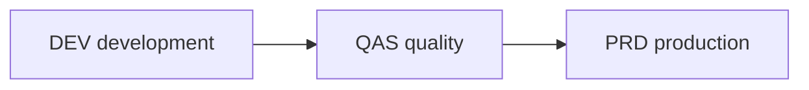

# Transport landscape

This is a sample explanation. The system ids are examples. Copy it as a starting point, or delete it.

## Overview

The landscape has three systems: development (`DEV`), quality (`QAS`) and production (`PRD`). Every change is made in `DEV` and travels as a transport request to `QAS` and then to `PRD`.

## Details

Transports are imported in the same order in every system. If a request is imported in `PRD` before an older one it depends on, objects can end up in an older version than in `QAS`.

The transport management system (transaction `STMS`) holds the import queues. Imports into `PRD` happen only in the agreed time slots, after the test teams approve the changes in `QAS`. Technical changes such as a [kernel update](kernel-update-qas.md) follow the same order, even though they are not transports.

## References

- [Kernel update in the quality system](kernel-update-qas.md)
